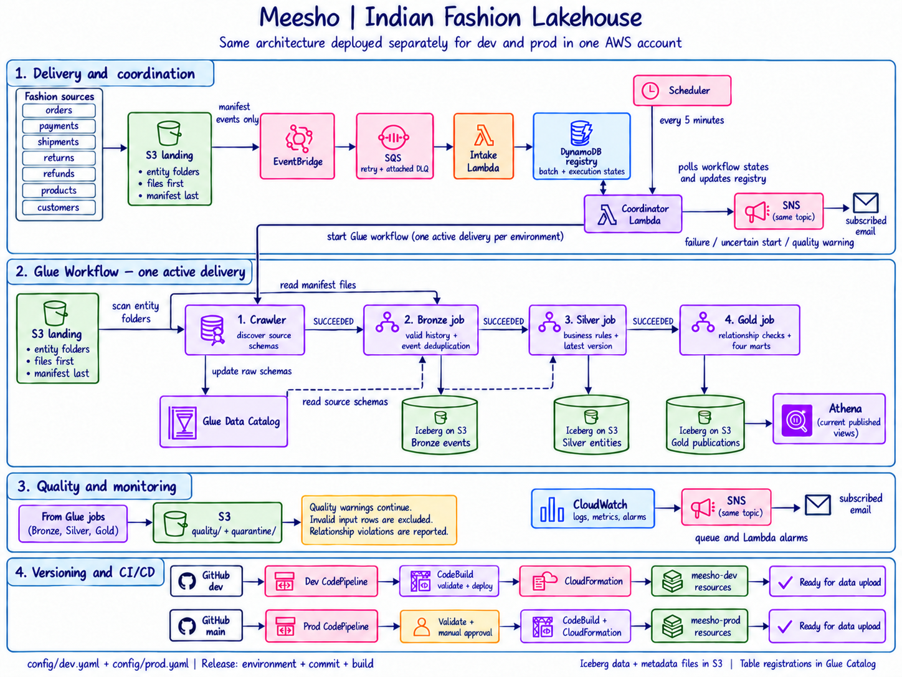
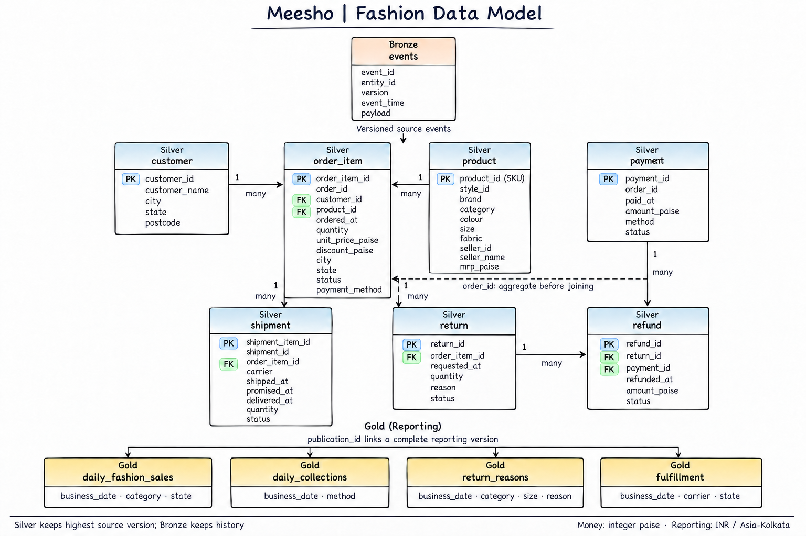

# Meesho — Indian Fashion Operations Lakehouse

This project models fashion operations for Meesho: apparel, independent sellers, prepaid and cash-on-delivery orders, split order fulfillment, and fit-related returns.

## Problem statement

Fashion operations teams need a consistent account of what customers ordered, what was shipped, which sizes and styles were returned, and how much cash was collected after refunds. Order management, payment, warehouse, carrier, and return systems describe different parts of that lifecycle. Their deliveries can overlap, arrive late, contain corrections, or fail halfway through processing.

The platform preserves source evidence and publishes analytical datasets without double-counting repeated deliveries. DynamoDB tracks each delivery and its current workflow attempt, deployed release, execution states and publication. Quality results and quarantine records remain in S3. Historical corrections pass through the same processing path as daily deliveries. Quality checks are advisory: publications can contain warnings and must not automatically be treated as reconciled financial results.

The product provides:

- Sales by apparel category and delivery state, using order-time prices.
- Captured payments, completed refunds, and net cash collections by day and payment method.
- Return demand by category, size, and reason.
- Carrier delivery performance and return-to-origin counts.
- Delivery and execution tracking in DynamoDB, with quality results, quarantined records and CloudWatch diagnostics.

**Start with [RUNBOOK.md](RUNBOOK.md)** for prerequisites, deployment, validation, operations, and recovery. The repository contains application code and existing data files; it contains no source-data generator.

## Code versioning and CI/CD

**One AWS account, one GitHub repository, two environments in US East (N. Virginia), `us-east-1`.** After the one-time Console setup, a branch push deploys the environment and its permissions. Uploading data then starts processing automatically.

| Git branch | Configuration | Pipeline | Resource prefix | Glue database prefix | Deployment |
|---|---|---|---|---|---|
| `dev` | [config/dev.yaml](config/dev.yaml) | `meesho-dev-delivery` | `meesho-dev-*` | `meesho_dev_*` | Automatic after validation |
| `main` | [config/prod.yaml](config/prod.yaml) | `meesho-prod-delivery` | `meesho-prod-*` | `meesho_prod_*` | Validation, production approval, deployment |

```text
Once: authorize GitHub → upload bootstrap.yaml in the CloudFormation Console
      → AWS creates CI/CD, artifact storage, encryption and deployment roles

Push to dev → dev CodePipeline → validate → deploy foundation + platform
            → development environment ready for data upload

Merge reviewed dev changes into main → prod CodePipeline → validate → approve
            → deploy foundation + platform → production ready for data upload

Upload data + ready manifest → Crawler → Bronze → Silver → Gold → Athena views
```

Each pipeline watches only its configured branch through CodeConnections. Protect `main` in GitHub to require reviewed pull requests: AWS detects branch pushes, so preventing direct pushes is a repository setting. Git tags and other branches do not trigger these pipelines.

The environments have separate data/artifact buckets, KMS keys, DynamoDB registries, queues, Lambdas, Glue resources, Athena workgroups and IAM roles. They share the account, Region, repository, authorized GitHub connection and account quotas. Each environment admits one workflow at a time. Resource separation within one account is not an account-level security boundary.

### What a push does

1. **Validate the captured commit.** CodeBuild checks the branch/configuration pairing, runs offline tests and validates all CloudFormation templates.
2. **Pause admissions for an existing environment.** The coordinator records a maintenance gate and drains the active delivery before code is replaced. A new environment skips this step.
3. **Deploy the data foundation.** CloudFormation creates or updates the encrypted, versioned data bucket and its landing policy.
4. **Publish the code release and deploy the platform.** CodeBuild packages the Lambda code, Glue scripts and Athena SQL; CloudFormation creates or updates all runtime services and their IAM permissions.
5. **Check readiness and enable processing.** CodeBuild verifies the crawler and three-job workflow definition, enables its schedule and removes the maintenance gate.

The build discovers bucket names and passes role/key references internally. No terminal exports or manual service-role creation are needed. `alert_email` in each configuration optionally creates an SNS email subscription; the recipient confirms the subscription once.

CI prepares infrastructure without submitting business deliveries. The uploader finds the correct bucket from the selected environment. Gold creates/refreshes Athena views during data processing, after their underlying tables exist. A successful deployment establishes infrastructure readiness; the first successful data delivery verifies processing in the AWS account.

### What identifies a version?

| Identifier | Meaning | Where it is used |
|---|---|---|
| Git commit | Exact source revision | Pull request, pipeline source revision, build logs |
| Release tag | For example `v1.0.0`, a readable name for a verified production commit | GitHub history; tag push does not deploy |
| Deployment release ID | `<environment>-<full-commit-sha>-<build-number>` | Immutable S3 release directory, CloudFormation `ReleaseId`, DynamoDB batch `release_id` |
| Source entity version | Integer in a business event | Silver corrections and late-arrival handling |
| Iceberg snapshot / Gold publication | Table commit / complete reporting version | Historical queries and consistent reporting |

Production packages the captured `main` revision into its own artifact bucket. A merge commit can have a different SHA from the verified development commit; the reviewer checks the corresponding development execution and reviewed changes. Reverting application code through Git produces a new deployment; it does not revert business data or automatically reverse schema changes.

### Where it is implemented

| File | Responsibility |
|---|---|
| [cloudformation/bootstrap.yaml](cloudformation/bootstrap.yaml) | One Console submission per environment creates CI/CD storage, key, roles, builds and branch-specific pipeline |
| [buildspec-check.yml](buildspec-check.yml) | Branch/configuration checks, offline tests and template validation |
| [buildspec.yml](buildspec.yml), [ops/deploy.py](ops/deploy.py) | First deployment, safe updates, immutable packaging and readiness checks |
| [cloudformation/foundation.yaml](cloudformation/foundation.yaml) | Data bucket and landing policy, deployed automatically by CI |
| [cloudformation/platform.yaml](cloudformation/platform.yaml) | All runtime resources, permissions, monitoring and optional SNS subscription, deployed automatically by CI |

YAML comments explain the sections, references, IAM roles and execution phases. The bootstrap owns the CI/CD trust setup: changes to the pipeline itself or its deployment permissions require a Console update to that stack. Application, data-foundation and runtime-permission changes deploy through Git.

Follow [RUNBOOK.md](RUNBOOK.md) in order: GitHub and local setup, the connection, one bootstrap stack, the automatic deployment, then data upload. Add production after development succeeds. No AWS resources or GitHub connection have been created from this workspace.

## Architecture



1. `ops/upload_delivery.py` verifies the supplied file hashes and counts, uploads immutable data objects, and writes a ready manifest last.
2. S3 manifest creation reaches EventBridge, SQS, and the intake Lambda. The SHA-256 of the manifest identifies a batch in DynamoDB.
3. The coordinator admits one delivery at a time into a Glue Workflow. DynamoDB retains ownership if the invocation stops unexpectedly.
4. The workflow starts its crawler. It discovers seven raw entity schemas in the Glue Data Catalog. A crawler-success trigger starts Bronze, followed by Silver and Gold through job-success triggers.
5. Bronze and Silver read source types from the Catalog. Invalid or conflicting rows go to quarantine; valid rows continue. Gold reports relationship warnings, writes four reporting tables with a publication ID, and commits the publication pointer last.
6. Gold automatically creates/refreshes the Athena views, which expose the current publication. Consumers can pin a publication ID for reports that issue several queries.
7. Every five minutes the coordinator polls the actual crawler/job states, stores a compact summary in the DynamoDB batch, and releases ownership after all four workflow actions succeed and publication is confirmed. It sends SNS notifications for execution failures, uncertain starts, and completed deliveries with quality warnings. CloudWatch alarms also publish to the same topic.

| Component | Purpose |
|---|---|
| S3 landing | Original JSONL files and immutable manifests; versioning and content-addressed keys |
| EventBridge / SQS / DLQ | Event routing, durable buffering, partial-batch retries, exhausted-message retention |
| Two processing Lambda functions | Intake and coordinator for dispatch, status checks, recovery and notifications |
| DynamoDB | Batch state, attempt, workflow claim, release, publication, quality status and crawler/job summaries |
| Glue Workflow | Crawler → Bronze → Silver → Gold; one concurrent workflow |
| Glue Spark 5.0 | Explicit transformations, source-version merges, quality checks, publishing |
| Glue Data Catalog / Iceberg v2 | Schemas, atomic table commits, snapshots and analytical storage |
| Glue Crawler | Required first workflow step; discovers raw entity schemas before processing |
| Glue Data Quality | Advisory required-key, uniqueness and reporting-date checks; results saved even when checks fail |
| Athena engine 3 | Business views, time travel and table maintenance |
| CloudWatch / SNS | Logs, dashboard, coordinator failure/quality notifications, DLQ and queue-age alarms |
| CloudFormation / CodeBuild / CodePipeline | Automatic infrastructure/permission setup, validation, approval, deployment and readiness checks |
| IAM / KMS | Project-scoped service permissions and encrypted S3 storage |

The account's CloudTrail configuration and any organizational Lake Formation policies are prerequisites governed by the account owner, not silently changed by these stacks. The default deployment uses IAM-authorized Glue Catalog access. Accounts governed by Lake Formation need their account owner to grant equivalent Catalog permissions to the generated runtime role before processing.

Bootstrap also creates a CloudFormation deletion helper. It runs only for stack lifecycle requests, outside the delivery flow shown above; it does not collect audit events.

## Resource deletion

All three templates explicitly delete their resources on stack deletion, including storage and delivery history. **Delete an environment in this order: platform → foundation → bootstrap.** CloudFormation imports prevent removing storage or bootstrap while the application still depends on them. Follow [the Console retirement steps in RUNBOOK.md](RUNBOOK.md#14-delete-an-environment-and-its-data) to stop activity first.

Cleanup automatically empties both versioned buckets, including delete markers and unfinished uploads, removes CodeBuild history/logs and project-owned Glue log streams, and disables registry recovery before table deletion. CloudFormation removes the remaining services, roles, databases, alarms and dedicated log groups. Normal in-place deployments preserve data; deletion is permanent.

The KMS key is scheduled for deletion after AWS's minimum seven-day wait. Shared/pre-existing resources such as the GitHub connection are outside these stacks; AWS-managed metrics/history and Glue metadata cleanup follow service retention behavior. For an existing deployment, first update bootstrap through the Console and deploy the revised foundation/platform through CI. Local template edits do not change its installed deletion behavior. [AWS KMS deletion timing](https://docs.aws.amazon.com/AWSCloudFormation/latest/TemplateReference/aws-resource-kms-key.html).

## Data included

All customers, sellers, IDs and transactions are synthetic. Indian cities, PIN-code areas, payment methods and carrier names provide realistic operating context. No contact details or private customer records are included.

The initial delivery contains September 2026 source history in shuffled arrival order. It represents a **100,000-business-event acceptance delivery**, not a measured 100,000-events-per-day throughput result.

| Record group | Count |
|---|---:|
| Order-item state-change events | 60,000 |
| Payment events | 10,000 |
| Shipment state-change events | 24,000 |
| Return events | 3,000 |
| Refund events | 3,000 |
| Customer reference events | 6,000 |
| Product/SKU reference events | 600 |
| Deliberate duplicate rows | 500 |
| **Physical input rows** | **107,100** |
| **Distinct Bronze events** | **106,600** |

There are 10,000 orders and 20,000 order items. Products include kurta sets, sarees, T-shirts, shirts, jeans, trousers, dresses and kidswear. Sizes, fabrics, colours, fictional brands and sellers are represented explicitly. Payment methods include UPI, card, net banking and COD. Returns include size, colour, fabric, damage and change-of-mind reasons.

Files under `data/delivery/` are JSON Lines in seven entity folders, with a local `manifest.json`. Records remain shuffled within each entity; the 107,100 source rows and their original bytes are unchanged. Each manifest file entry includes `entity`, `path`, `rows` and `sha256`. Uploads use `landing/objects/<entity>/<sha256>.jsonl`. `data/expected.json` contains independently checkable acceptance counts and cash totals. `data/recovery/` contains separate, small deliveries for an old-version replay and a deliberately invalid contract. These recovery files are not part of the initial delivery.

## Data model



### Source contract

Every event contains `event_id`, `entity_type`, `entity_id`, `version`, `event_time`, `source_system`, `schema_version`, and `payload`. Identifiers are opaque, nonsequential business IDs. Product IDs identify a specific SKU, not just a style.

A repeated event must retain the same ID and byte-equivalent serialized envelope. A correction uses a new event ID and a greater entity version. Timestamps use UTC with a `Z` suffix. Source monetary amounts use integer paise; Gold displays decimal INR. Reporting dates use `Asia/Kolkata`.

The crawler-created `raw.discovered_<entity>` tables supply source names and types, including the nested `payload` structure. `common.Run.source_schema()` calls Glue `GetTable` and lets Spark parse the returned column definitions. Python contains business keys and checks in `src/glue/contracts.py`, **not source schema declarations**. Jobs read only the current manifest files, not every row covered by the raw Catalog table.

Unknown event schema versions and invalid mandatory values are quarantined and excluded, without blocking publication. The initial delivery must provide all seven entity schemas; subsequent deliveries may contain only changed entities. The crawler updates raw metadata on every run. A missing/incompatible schema needed by a transformation is an execution/configuration error; existing Iceberg tables still require reviewed schema migrations.

### Bronze

`bronze.events` contains one row per event ID, partitioned by event day. It preserves event history, payload JSON, the original source file, a content hash, and the first batch that inserted the event. Repeated notifications or repeated events do not append duplicate history. Invalid source files remain in landing; invalid rows are also written to quarantine.

### Silver

All physical Silver tables keep the highest accepted source version. They also retain `entity_id`, `version`, `event_time`, `event_id`, and `payload_hash` for lineage.

| Table | Grain / key | Relationships and business fields |
|---|---|---|
| `customer` | One current customer; `customer_id` | Name, city, state, PIN-code area, join date |
| `product` | One SKU; `product_id` | Style, brand, category, gender, colour, size, fabric, seller, MRP |
| `order_item` | One order line; `order_item_id` | `order_id`, customer, SKU, quantity, actual price, discount, order-time geography, status, payment method |
| `payment` | One payment transaction; `payment_id` | Order, amount, method, provider reference, capture status/time |
| `shipment` | One shipment allocation to an order line; `shipment_item_id` | Shipment ID, order line, carrier, warehouse, quantity, promised/shipped/delivered times |
| `return` | One return request; `return_id` | Order line, quantity, reason, status, request time |
| `refund` | One refund transaction; `refund_id` | Return, payment, amount, status, completion time |

`silver.orders` is a derived Athena view, not an eighth physical table. Gold reports whether all lines of an order agree on header attributes. A warning does not block this view, so review warnings before interpreting its totals.

Customers and products have one-to-many relationships to order items. Order items have one-to-many relationships to shipment allocations and return requests. Payments and return requests each have one-to-many relationships to refunds. Payments associate with order items through `order_id`; aggregate each side before joining to avoid multiplying cash amounts.

Current customer geography does not overwrite delivery geography. Current catalogue MRP does not overwrite actual order-line prices. Full source history remains in Bronze. Product/customer SCD2 tables are deliberately not introduced: the facts already carry the historical attributes needed by the implemented metrics.

### Gold

Each table contains a complete reporting version, identified by `publication_id`.

| Table | Grain within a publication | Measures |
|---|---|---|
| `daily_fashion_sales` | Business date, category, state | Distinct orders within the group, booked units/value, cancelled units |
| `daily_collections` | Business date, payment method | Captured cash, completed refunds, net collected cash |
| `return_reasons` | Request date, category, size, reason | Accepted return requests and units |
| `fulfillment` | Ship date, carrier, state | Shipment allocations, delivered allocations, on-time deliveries, RTO allocations |

Booked value excludes cancelled lines but is not reduced by subsequent returns. Return units and refunded cash are separate measures. Net collections are captures minus completed refunds, **not accounting revenue**. Order counts are not additive across categories. Fulfillment counts allocations, not unique parcels or units.

`gold.publication_current` contains the current reporting version. The `current_*` Athena views join through it. Raw Gold tables remain available for explicitly pinned historical publications; row counts across all publications must not be interpreted as current business totals.

## Correctness and recovery

- **At-least-once events:** SQS retries and repeated S3 notifications are expected. Intake uses conditional registration; Bronze merges event IDs.
- **Out-of-order updates:** Silver selects the highest source version. An old event cannot regress current state.
- **Deployment maintenance:** A `MAINTENANCE` registry item blocks new admissions while an existing workflow drains and resources are updated. Pending deliveries resume after a successful deployment.
- **Partial table commits:** A failed delivery retains the workflow claim. No subsequent ordinary delivery can publish over an unresolved partial batch.
- **Retry:** Reprocess the same immutable manifest. Silver merges remain version-aware; Gold writes a new reporting version rather than adding totals again.
- **Recovery with additional evidence:** A replacement delivery must include every original file plus the correcting or missing events. The failed batch links to the replacement.
- **Quality warnings:** Invalid envelopes/payloads and conflicting IDs/versions are quarantined and excluded. Glue DQ failures and Gold relationship violations are recorded without aborting the workflow. An all-quarantined delivery can succeed with warnings and no accepted new data.
- **Execution failure withdrawal:** An execution-failed batch can be rejected only before any Silver write has been attempted. Quality warnings alone do not require rejection.
- **Ambiguous workflow start:** The coordinator searches for a matching batch/attempt. If it cannot establish the outcome, it marks `NEEDS_REVIEW` rather than starting another run blindly.
- **Execution tracking:** The coordinator reads actual crawler/job states from the workflow graph and stores the latest attempt on the batch item. Landing-manifest reconciliation repairs missed intake notifications. Previous execution details remain in Glue/CloudWatch under their service retention policies.

Iceberg commits are atomic per table. The workflow is not a transaction across Iceberg, DynamoDB, and S3. The publication pointer, retained batch ownership, idempotent writes and coordinator status reconciliation cover those boundaries explicitly.

## Quality outcomes and execution tracking

| Check | Evidence / row treatment | Pipeline behavior |
|---|---|---|
| Invalid envelope, unsupported event version, event-ID conflict | Bronze quarantine; exclude rejected rows | Continue with accepted events |
| Invalid payload, business rule, conflicting entity version | Silver quarantine; exclude rejected rows | Continue with valid latest versions |
| Glue DQ rule failure | Glue DQ results plus a JSON summary in `quality/` | Continue; record `quality_status=WARNING` |
| Empty accepted input | `EMPTY_DATASET` warning instead of running column analyzers | Continue; existing state remains, empty initial tables can be created |
| Missing reference / cross-table limit violation | Gold quarantine contains offending keys; Silver is not deleted | Publish with warning; joins can omit unmatched rows and totals may be incomplete or inconsistent |
| S3/KMS/IAM/API error, incompatible required schema, Spark error, failed Iceberg commit | Glue/CloudWatch error and DynamoDB execution status | Fail; keep `CONTROL` for recovery |

Results live under `quality/<batch_id>/<workflow_run_id>/`; quarantined rows live under `quarantine/<batch_id>/<workflow_run_id>/`. Retries use a new workflow ID, preserving earlier quality evidence. `quality_warning_count` counts failed checks, **not** rejected rows; each result records its own affected count. A failed dataset-level Glue DQ rule does not itself identify row-level quarantine candidates.

There is one `BATCH#<id>` DynamoDB item per manifest, a `CONTROL` item while a delivery owns the workflow, and a `MAINTENANCE` item while admissions are paused for deployment. The batch stores `execution_steps` (crawler/job state, start/end time and error), `workflow_status`, `checked_at`, `release_id`, `attempt`, `publication_id`, `quality_status` and `quality_warning_count`. It stores the **latest attempt**, not a separate history of every job. The coordinator reads this state and sends SNS notifications; confirmed topic subscribers receive them. Standard SNS delivery can repeat.

The separate job-event rule, audit Lambda, S3 audit writer, operational database and Athena audit views have been removed. EventBridge remains only for ready-manifest intake, and EventBridge Scheduler invokes the coordinator. Quality results are retained because they explain rejected data and reporting limitations.

## Repository map

```text
meesho-lakehouse/
├── README.md                  Product, architecture, contracts and model
├── RUNBOOK.md                 Sequential deployment and operations instructions
├── config/                    dev.yaml and prod.yaml branch/environment settings
├── cloudformation/            Commented bootstrap, foundation and platform templates
├── src/lambdas/               intake.py, coordinator.py
├── src/glue/                  bronze.py, silver.py, gold.py, common.py, contracts.py
├── ops/                       Automatic deployment, packaging, upload and recovery helpers
├── sql/                       Views, business queries and maintenance
├── tests/                     Offline data and failure-window tests
├── data/                      Existing JSONL deliveries, manifests and expected totals
├── docs/images/               The two hand-sketched diagrams
├── buildspec-check.yml        CI validation
└── buildspec.yml              Automatic infrastructure deployment and readiness checks
```

## Validation and operating limits

Offline validation covers manifest hashes/counts, duplicate content, source-version uniqueness, referential integrity, refund caps, financial totals, late arrival and Lambda failure windows. `tests/check_spark.py` optionally executes the actual SQL and contract predicates with local Spark. `ops/smoke.py` is an optional AWS acceptance helper that submits the supplied delivery and checks its fixed Athena totals; it is not run by CI. A local pass does not establish that account permissions, Glue quotas, networking or runtime behavior have passed AWS integration.

Validation completed locally on 17 October 2026: **56 offline tests passed**, all three CloudFormation templates passed `cfn-lint`, and the inline cleanup Lambda compiled. Tests cover first deployment, failed-update maintenance, environment isolation, automatic view creation, versioned-bucket cleanup, deletion ordering, active-run checks and rollback protection. No AWS stacks have been deployed, deleted or integration-tested from this workspace.

The full dataset passed the Spark 3.5.4 contract/relationship/Gold-SQL check on 16 October 2026. The three job functions also completed all-quarantined and mixed valid/invalid deliveries with missing-reference warnings, with AWS storage/commit boundaries replaced for those checks. Verified net collections: **₹24,099,253.00**; booked value: **₹33,596,103.00**.

The implementation uses one active workflow, two G.1X workers per job, and full Gold recomputation from current Silver state. These choices keep recovery and code straightforward at the supplied dataset size. A 30-minute freshness target is an acceptance objective to benchmark after deployment. Higher sustained volumes may require measured changes to writer concurrency, partitioning and incremental Gold computation.

The supplied delivery can be uploaded independently to either environment. Its fixed acceptance totals apply only to that data and compatible recovery fixtures; other operational deliveries need their own reconciliation controls. Development can fail or be replayed without changing production state.

## Reference documentation

- [Glue 5.0 runtime and bundled Iceberg](https://docs.aws.amazon.com/glue/latest/dg/release-notes.html)
- [Iceberg in Glue](https://docs.aws.amazon.com/glue/latest/dg/aws-glue-programming-etl-format-iceberg.html)
- [Glue Workflow semantics](https://docs.aws.amazon.com/glue/latest/dg/workflows_overview.html)
- [Crawler-success workflow triggers](https://docs.aws.amazon.com/AWSCloudFormation/latest/TemplateReference/aws-properties-glue-trigger-condition.html)
- [Crawler grouping by S3 include path](https://docs.aws.amazon.com/glue/latest/dg/crawler-grouping-policy.html)
- [Workflow graph job/crawler states](https://docs.aws.amazon.com/glue/latest/dg/aws-glue-api-workflow.html)
- [SQS partial-batch failures](https://docs.aws.amazon.com/lambda/latest/dg/services-sqs-errorhandling.html)
- [Glue Data Quality](https://docs.aws.amazon.com/glue/latest/dg/tutorial-data-quality.html)
- [Athena Iceberg compatibility](https://docs.aws.amazon.com/athena/latest/ug/querying-iceberg.html)
- [Iceberg maintenance safeguards](https://docs.aws.amazon.com/glue/latest/dg/optimizer-notes.html)
- [GitHub source revisions and automatic change detection](https://docs.aws.amazon.com/codepipeline/latest/userguide/action-reference-CodestarConnectionSource.html)
- [CodeBuild phases and failure behavior](https://docs.aws.amazon.com/codebuild/latest/userguide/build-spec-ref.html)
- [CloudFormation parameter rules](https://docs.aws.amazon.com/AWSCloudFormation/latest/UserGuide/rules-section-structure.html)
- [CodeBuild source-version variables](https://docs.aws.amazon.com/codebuild/latest/userguide/build-env-ref-env-vars.html)

<details>
<summary>Architecture image editing record</summary>

The architecture image is saved at `docs/images/architecture.png`. Its CI/CD lane was revised with the built-in ImageGen tool, preserving the existing hand-sketched diagram. Final edit prompt:

> Use case: text-localization. Asset type: existing hand-sketched AWS architecture diagram in project README. Input image is the edit target. Preserve this exact complete diagram, title, opaque white/light background, landscape format, all three upper lanes, all labels and arrows, and the hand-drawn style. Change only the bottom lane named "4. Versioning and CI/CD": in BOTH far-right purple boxes replace the icons and text "Glue + Athena verification" with the exact text "Ready for data upload" and a simple small checkmark. These boxes follow meesho-dev resources and meesho-prod resources respectively. Keep every other box, text, flow and position unchanged. Make the replacement text legible and uncluttered. Do not introduce transparency or crop the diagram.

</details>
